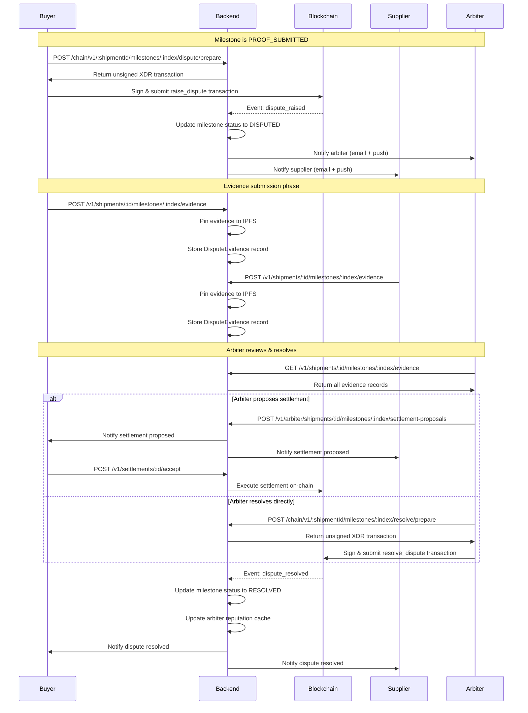

# Disputes, Evidence & Arbitration Flow

This document explains how disputes are raised on ChainSettle, how evidence is submitted by both parties, how arbiters resolve disputes, and how the resolution feeds back into arbiter reputation.

---

## Table of Contents

- [Overview](#overview)
- [Dispute Flow Sequence](#dispute-flow-sequence)
- [Raising a Dispute](#raising-a-dispute)
- [Submitting Evidence](#submitting-evidence)
- [Arbiter Assignment & Acceptance](#arbiter-assignment--acceptance)
- [Arbiter Resolution](#arbiter-resolution)
- [Settlement Proposals](#settlement-proposals)
- [Dispute Escalation](#dispute-escalation)
- [Reputation Impact](#reputation-impact)
- [API Endpoints Summary](#api-endpoints-summary)
- [Related Documentation](#related-documentation)

---

## Overview

Disputes occur when a buyer challenges the proof submitted by a supplier for a milestone. The dispute lifecycle involves:

1. **Buyer raises a dispute** on-chain when proof is unsatisfactory
2. **Both parties submit evidence** to support their claims (photos, documents, descriptions)
3. **Arbiter reviews evidence** and may propose a settlement or resolve unilaterally
4. **Resolution is executed on-chain**, distributing escrowed funds according to the arbiter's ruling
5. **Arbiter reputation is updated** based on resolution outcome and timing

All disputes are tracked in milestone status transitions:

```
PROOF_SUBMITTED ──> DISPUTED ──> RESOLVED
```

Once a milestone enters `DISPUTED` status, only the assigned arbiter can move it to `RESOLVED`. The buyer and supplier cannot directly confirm or reject a disputed milestone.

---

## Dispute Flow Sequence



---

## Raising a Dispute

### Who Can Raise a Dispute

Only the **buyer** may raise a dispute. Suppliers and arbiters cannot initiate disputes.

### When Can a Dispute Be Raised

A dispute may only be raised when:
- The milestone is in `PROOF_SUBMITTED` status
- The shipment is `ACTIVE` (not `CANCELLED` or `COMPLETED`)
- The caller is the shipment buyer

### How to Raise a Dispute

Disputes are raised **on-chain** using a two-step process:

#### 1. Prepare the transaction (off-chain)

```http
POST /api/v1/chain/:shipmentId/milestones/:index/dispute/prepare
Authorization: Bearer <jwt-token>
Content-Type: application/json

{
  "reason": "Delivered goods do not match the specification. Photos show incorrect product model."
}
```

**Request Body** (`RaiseDisputePrepareDto`):
| Field    | Type   | Required | Max Length | Description                                      |
|----------|--------|----------|------------|--------------------------------------------------|
| `reason` | string | No       | 500 chars  | Human-readable explanation for the dispute       |

**Response**:
```json
{
  "xdr": "AAAAAgAAAAB...",
  "networkPassphrase": "Test SDF Network ; September 2015"
}
```

The `reason` field is stored on-chain as part of the transaction memo or contract invocation arguments. It helps arbiters understand the context without reading evidence records first.

#### 2. Sign & submit the transaction (on-chain)

The client signs the XDR using the buyer's Stellar keypair and submits it to the Horizon API. Once the transaction is confirmed, the `dispute_raised` event is emitted by the smart contract.

#### 3. Backend processes the event

The **EventsService** polls Stellar events. When it detects a `dispute_raised` event:
- `MilestonesService.markDisputed(shipmentId, milestoneIndex)` is called
- Milestone status transitions to `DISPUTED`
- `disputedAt` timestamp is recorded
- Arbiter receives a **MILESTONE_DISPUTED** notification (email + push)
- Supplier receives a **MILESTONE_DISPUTED** notification (email + push)

**Source**: [`src/modules/milestones/milestones.service.ts`](../src/modules/milestones/milestones.service.ts) — `markDisputed()` method.

---

## Submitting Evidence

Both the **buyer** and **supplier** may submit evidence to support their case. Evidence consists of:
- A **description** (up to 5,000 characters)
- An optional **file attachment** (PDF, image, or video) pinned to IPFS

The arbiter assigned to the shipment may also view all evidence but typically does not submit their own.

### Evidence Submission Endpoint

```http
POST /api/v1/shipments/:shipmentId/milestones/:index/evidence
Authorization: Bearer <jwt-token>
Content-Type: multipart/form-data

description: "Photos showing damaged goods upon delivery. The packaging was torn and items were broken."
file: <binary file data>
```

**Request Body** (`SubmitDisputeEvidenceDto`):
| Field         | Type   | Required | Max Length | Description                                      |
|---------------|--------|----------|------------|--------------------------------------------------|
| `description` | string | Yes      | 5,000 chars| Explanation of the evidence being submitted      |
| `file`        | binary | No       | —          | File upload (PDF, image, MP4) pinned to IPFS     |

**Response**:
```json
{
  "id": "clx12345abcdef",
  "milestoneId": "clw98765fedcba",
  "submittedBy": "GBUY...XYZ",
  "description": "Photos showing damaged goods...",
  "ipfsCid": "bafybeiabc123...",
  "ipfsUrl": "https://gateway.lighthouse.storage/ipfs/bafybeiabc123...",
  "fileName": "evidence-photo.jpg",
  "mimeType": "image/jpeg",
  "fileSize": 245678,
  "submittedAt": "2026-05-30T14:32:00.000Z"
}
```

### Who Can Submit Evidence

- **Buyer** (the party who raised the dispute)
- **Supplier** (the party defending the submitted proof)
- **Admins** (for exceptional cases)

Arbiters can view evidence but typically do not submit it themselves. Evidence visibility follows **shipment participant rules** — only users involved in the shipment (buyer, supplier, arbiter, or admin) may view evidence records.

### Evidence Storage

- **Description**: Stored in the `DisputeEvidence` table in PostgreSQL
- **File attachment**: Pinned to IPFS using the `IPFSService` (via Lighthouse or Pinata, depending on configuration)
- **IPFS CID**: Stored in the `ipfsCid` field of the `DisputeEvidence` record
- **Gateway URL**: Constructed dynamically using the configured IPFS gateway (e.g., `https://gateway.lighthouse.storage/ipfs/<cid>`)

### Viewing Evidence

All evidence submitted for a milestone can be retrieved by shipment participants:

```http
GET /api/v1/shipments/:shipmentId/milestones/:index/evidence
Authorization: Bearer <jwt-token>
```

**Response**:
```json
[
  {
    "id": "clx12345abcdef",
    "submittedBy": "GBUY...XYZ",
    "description": "Photos showing damaged goods...",
    "ipfsCid": "bafybeiabc123...",
    "ipfsUrl": "https://gateway.lighthouse.storage/ipfs/bafybeiabc123...",
    "fileName": "evidence-photo.jpg",
    "mimeType": "image/jpeg",
    "fileSize": 245678,
    "submittedAt": "2026-05-30T14:32:00.000Z"
  },
  {
    "id": "clx67890ghijkl",
    "submittedBy": "GSUPP...ABC",
    "description": "Invoice and delivery receipt confirming correct items were shipped.",
    "ipfsCid": "bafybeifgh456...",
    "ipfsUrl": "https://gateway.lighthouse.storage/ipfs/bafybeifgh456...",
    "fileName": "delivery-receipt.pdf",
    "mimeType": "application/pdf",
    "fileSize": 102400,
    "submittedAt": "2026-05-30T16:15:00.000Z"
  }
]
```

### Downloading Evidence Files

Evidence files can be downloaded through a backend proxy to avoid CORS issues and provide access control:

```http
GET /api/v1/shipments/:shipmentId/milestones/:index/evidence/:evidenceId/download
Authorization: Bearer <jwt-token>
```

The backend:
1. Verifies the caller is a shipment participant
2. Fetches the file from IPFS using the stored `ipfsCid`
3. Streams the file back to the client with appropriate `Content-Type` and `Content-Disposition` headers

**Source**: [`src/modules/milestones/milestones.service.ts`](../src/modules/milestones/milestones.service.ts) — `downloadEvidence()` method.

---

## Arbiter Assignment & Acceptance

Every shipment must have an **arbiter** assigned at creation time. The arbiter is identified by their Stellar address (`arbiterAddress` field on the `Shipment` record).

### Arbiter Invitation Flow

When a shipment is created:
1. The buyer specifies an arbiter address (e.g., `GARB...XYZ`)
2. The backend creates the shipment with `arbiterStatus: PENDING_ACCEPTANCE`
3. The arbiter receives an **ARBITER_INVITED** notification (email + push)

The arbiter must then **accept** or **decline** the invitation:

#### Accept Invitation

```http
POST /api/v1/arbiter/shipments/:shipmentId/accept
Authorization: Bearer <arbiter-jwt-token>
```

**Side Effects**:
- `arbiterStatus` set to `ACCEPTED`
- Buyer and supplier notified via **ARBITER_ACCEPTED** notification
- Arbiter may now view shipment details and resolve disputes

#### Decline Invitation

```http
POST /api/v1/arbiter/shipments/:shipmentId/decline
Authorization: Bearer <arbiter-jwt-token>
Content-Type: application/json

{
  "reason": "I am unavailable for the next 2 months due to travel."
}
```

**Side Effects**:
- `arbiterStatus` set to `DECLINED`
- Buyer notified via **ARBITER_DECLINED** notification
- Buyer must assign a new arbiter (on-chain and off-chain) before any disputes can be resolved

**Notes**:
- Arbiters cannot resolve disputes until they have **accepted** the shipment
- If an arbiter declines after a dispute has been raised, the dispute remains in `DISPUTED` status until a new arbiter is assigned and accepts

---

## Arbiter Resolution

Once the arbiter has reviewed the evidence, they may resolve the dispute in one of two ways:

### 1. Settlement Proposal (Collaborative Resolution)

The arbiter may propose a **settlement** that splits the escrowed funds between the buyer and supplier. Either party may accept the settlement, and acceptance triggers automatic on-chain execution.

See **[Settlement Proposals](#settlement-proposals)** below for details.

### 2. Unilateral On-Chain Resolution

The arbiter may resolve the dispute directly on-chain by invoking the `resolve_dispute` contract function. This is a two-step process similar to raising a dispute:

#### Step 1: Prepare the resolution transaction

```http
POST /api/v1/chain/:shipmentId/milestones/:index/resolve/prepare
Authorization: Bearer <arbiter-jwt-token>
Content-Type: application/json

{
  "supplierPercent": 60
}
```

**Request Body** (`ResolveDisputePrepareDto`):
| Field             | Type    | Required | Range    | Description                                      |
|-------------------|---------|----------|----------|--------------------------------------------------|
| `supplierPercent` | integer | Yes      | 0–100    | Percentage of milestone payment awarded to supplier |

**Response**:
```json
{
  "xdr": "AAAAAgAAAAC...",
  "networkPassphrase": "Test SDF Network ; September 2015"
}
```

**Interpretation of `supplierPercent`**:
- **100%**: Arbiter rules in favor of the supplier. Full milestone payment is released to the supplier.
- **0%**: Arbiter rules in favor of the buyer. Full milestone payment is refunded to the buyer.
- **50%**: Split ruling. Half the payment goes to the supplier, half is refunded to the buyer.
- **Any value 1–99%**: Partial ruling. Funds are distributed proportionally.

#### Step 2: Sign & submit the transaction

The arbiter signs the XDR and submits it to Horizon. Once confirmed, the `dispute_resolved` event is emitted.

#### Step 3: Backend processes the event

**EventsService** detects the `dispute_resolved` event:
- `MilestonesService.markResolved(shipmentId, milestoneIndex, supplierPercent)` is called
- Milestone status transitions to `RESOLVED`
- `confirmedAt` timestamp is recorded (for resolution time tracking)
- `paymentReleased` field is populated with the amount awarded to the supplier
- Buyer and supplier receive **DISPUTE_RESOLVED** notifications (email + push)
- **Arbiter reputation cache is updated** (see [Reputation Impact](#reputation-impact))

**Source**: [`src/modules/milestones/milestones.service.ts`](../src/modules/milestones/milestones.service.ts) — `markResolved()` method.

---

## Settlement Proposals

Settlement proposals allow arbiters to suggest a resolution without forcing it on-chain immediately. Either party may accept the proposal, and acceptance automatically executes the settlement on-chain.

### Creating a Settlement Proposal

```http
POST /api/v1/arbiter/shipments/:shipmentId/milestones/:index/settlement-proposals
Authorization: Bearer <arbiter-jwt-token>
Content-Type: application/json

{
  "supplierPercent": 70,
  "rationale": "Supplier delivered correct items but packaging was substandard. Partial payment is fair."
}
```

**Request Body**:
| Field             | Type    | Required | Range    | Description                                      |
|-------------------|---------|----------|----------|--------------------------------------------------|
| `supplierPercent` | integer | Yes      | 0–100    | Proposed percentage of payment for supplier      |
| `rationale`       | string  | No       | 2,000 chars | Explanation of the arbiter's reasoning        |

**Response**:
```json
{
  "id": "clx98765proposal",
  "milestoneId": "clw98765fedcba",
  "supplierPercent": 70,
  "rationale": "Supplier delivered correct items but packaging was substandard...",
  "status": "PENDING",
  "createdAt": "2026-05-31T10:00:00.000Z",
  "expiresAt": "2026-06-07T10:00:00.000Z"
}
```

**Side Effects**:
- Settlement proposal is stored in the `SettlementProposal` table
- Buyer and supplier receive **SETTLEMENT_PROPOSED** notifications (email + push)
- Proposal expires after **7 days** (configurable via `SETTLEMENT_PROPOSAL_EXPIRY_DAYS` environment variable)

### Accepting a Settlement Proposal

Either the buyer or supplier may accept the proposal:

```http
POST /api/v1/settlements/:proposalId/accept
Authorization: Bearer <buyer-or-supplier-jwt-token>
```

**Side Effects**:
- Proposal status set to `ACCEPTED`
- Backend automatically prepares and submits the `resolve_dispute` transaction on-chain using the proposed `supplierPercent`
- Milestone status transitions to `RESOLVED`
- Both parties notified via **DISPUTE_RESOLVED** notification
- Arbiter reputation is updated

**Notes**:
- If the proposal expires without acceptance, the arbiter may create a new proposal or resolve the dispute unilaterally
- Only **one active proposal** may exist per milestone at a time
- Settlement proposals are **immutable** once created (cannot be edited, only replaced)

**Source**: [`src/modules/milestones/settlement-proposals.service.ts`](../src/modules/milestones/settlement-proposals.service.ts).

---

## Dispute Escalation

If a dispute remains unresolved for an extended period, ChainSettle automatically escalates it to **platform admins** for manual intervention.

### How Escalation Works

The **DisputeEscalationJob** runs **hourly** (cron: `0 * * * *`). It:

1. Queries all milestones with:
   - `status = DISPUTED`
   - `updatedAt < (now - DISPUTE_ESCALATION_DAYS days)` (default: 7 days)
   - `disputeEscalatedAt = null` (not already escalated)

2. For each overdue dispute:
   - Sends a **SYSTEM_ALERT** notification to **every admin user** on the platform
   - Sets `disputeEscalatedAt` to the current timestamp (prevents repeated alerts)
   - Logs the escalation event

3. The notification includes:
   - Shipment ID and milestone index
   - Arbiter address
   - Number of days the dispute has been unresolved
   - Whether the arbiter is marked as "away" (`arbiterAwayUntil` is set and in the future)

### Escalation Threshold

Controlled by the **`DISPUTE_ESCALATION_DAYS`** environment variable (default: `7` days).

Example: If a dispute is raised on May 30 at 10:00 AM and remains `DISPUTED` with no updates, the escalation job will flag it on June 6 at 10:00 AM (assuming `DISPUTE_ESCALATION_DAYS=7`).

### Admin Response

Admins can view escalated disputes using the admin dashboard endpoint:

```http
GET /api/v1/admin/disputes?escalated=true
Authorization: Bearer <admin-jwt-token>
```

**Response**:
```json
[
  {
    "shipmentId": "clw12345shipment",
    "milestoneIndex": 1,
    "milestone": "Delivery Confirmation",
    "arbiterAddress": "GARB...XYZ",
    "ageHours": 168.5,
    "evidenceCount": 3,
    "escalated": true
  }
]
```

Admins may:
- Contact the arbiter directly to request action
- Reassign the arbiter if they are unresponsive or marked away
- In extreme cases, resolve the dispute on behalf of the arbiter (requires platform admin privileges)

**Source**: [`src/modules/milestones/dispute-escalation.job.ts`](../src/modules/milestones/dispute-escalation.job.ts).

---

## Reputation Impact

Every dispute resolution feeds into the arbiter's **reputation score**, which is publicly visible and used by buyers when selecting arbiters for new shipments.

### Reputation Metrics

For each arbiter, ChainSettle tracks:

| Metric                        | Description                                                                                  |
|-------------------------------|----------------------------------------------------------------------------------------------|
| `disputesHandled`             | Count of milestones resolved by this arbiter (status = `RESOLVED`)                          |
| `disputesOpen`                | Count of milestones currently in `DISPUTED` status assigned to this arbiter                 |
| `averageResolutionTimeHours`  | Mean time from dispute start to resolution, in hours                                         |
| `hasHistory`                  | `true` if the arbiter has handled at least one dispute; `false` for new arbiters            |

### How Resolution Time Is Measured

For each `RESOLVED` milestone:

```
resolutionTime = confirmedAt - startPoint
```

where `startPoint` is:
- `disputeEscalatedAt` (if the dispute was escalated), or
- `disputedAt` (if the dispute was resolved before escalation), or
- `createdAt` (fallback for legacy records)

Negative durations (clock skew, bad data) are excluded from the average.

### Reputation Refresh Cadence

Reputation is **not computed live** on every request. Instead:

- **ArbiterReputationJob** runs **every 6 hours** (cron: `0 */6 * * *`)
- It recomputes reputation for every known arbiter and caches the result in **Redis** with a **7-day TTL**
- `GET /api/v1/arbiters/:address/reputation` reads from the cache (falling back to live computation on cache miss)

**Forcing a Refresh**:

Admins may force an immediate recompute for a specific arbiter:

```http
POST /api/v1/admin/arbiters/:address/reputation/recompute
Authorization: Bearer <admin-jwt-token>
```

This is useful after resolving a batch of disputes when you want the reputation score to update immediately rather than waiting for the next scheduled job run.

### Viewing Reputation

Buyers can view an arbiter's reputation before creating a shipment:

```http
GET /api/v1/arbiters/:address/reputation
```

**Response**:
```json
{
  "arbiterAddress": "GARB...XYZ",
  "disputesHandled": 24,
  "disputesOpen": 2,
  "averageResolutionTimeHours": 18.42,
  "hasHistory": true,
  "computedAt": "2026-05-31T06:00:00.000Z"
}
```

**For arbiters with no history**:
```json
{
  "arbiterAddress": "GNEW...ABC",
  "disputesHandled": 0,
  "disputesOpen": 0,
  "averageResolutionTimeHours": null,
  "hasHistory": false,
  "computedAt": "2026-05-31T06:00:00.000Z"
}
```

New arbiters show as having **no history** (not an error) — this is intentional to allow new arbiters to be discovered in arbiter-selection UI without triggering 404 errors.

**Source**: [`docs/arbiter-reputation.md`](./arbiter-reputation.md) — full reputation documentation.

---

## API Endpoints Summary

### Dispute Lifecycle

| Endpoint                                                          | Method | Role                  | Description                                      |
|-------------------------------------------------------------------|--------|-----------------------|--------------------------------------------------|
| `/chain/v1/:id/milestones/:index/dispute/prepare`                | POST   | Buyer                 | Prepare unsigned `raise_dispute` transaction     |
| `/v1/shipments/:id/milestones/:index/evidence`                   | POST   | Buyer, Supplier       | Submit evidence (description + optional file)    |
| `/v1/shipments/:id/milestones/:index/evidence`                   | GET    | Participants          | List all evidence for a milestone                |
| `/v1/shipments/:id/milestones/:index/evidence/:evidenceId`       | GET    | Participants          | Fetch a single evidence record by ID             |
| `/v1/shipments/:id/milestones/:index/evidence/:evidenceId/download` | GET | Participants          | Download evidence file via backend proxy         |
| `/chain/v1/:id/milestones/:index/resolve/prepare`                | POST   | Arbiter               | Prepare unsigned `resolve_dispute` transaction   |

### Settlement Proposals

| Endpoint                                                          | Method | Role                  | Description                                      |
|-------------------------------------------------------------------|--------|-----------------------|--------------------------------------------------|
| `/arbiter/shipments/:id/milestones/:index/settlement-proposals`   | POST   | Arbiter               | Create a settlement proposal                     |
| `/settlements/:proposalId/accept`                                 | POST   | Buyer, Supplier       | Accept a settlement proposal (auto-executes)     |
| `/settlements/:proposalId`                                        | GET    | Participants          | View settlement proposal details                 |

### Arbiter Management

| Endpoint                                                          | Method | Role                  | Description                                      |
|-------------------------------------------------------------------|--------|-----------------------|--------------------------------------------------|
| `/arbiter/shipments/:id/accept`                                   | POST   | Arbiter               | Accept arbiter invitation                        |
| `/arbiter/shipments/:id/decline`                                  | POST   | Arbiter               | Decline arbiter invitation (with reason)         |
| `/arbiters/:address/reputation`                                   | GET    | Anyone                | View arbiter reputation summary                  |
| `/arbiters/:address/history`                                      | GET    | Anyone                | View arbiter dispute resolution history          |

### Admin Dispute Management

| Endpoint                                                          | Method | Role                  | Description                                      |
|-------------------------------------------------------------------|--------|-----------------------|--------------------------------------------------|
| `/admin/disputes`                                                 | GET    | Admin                 | List all open disputes across the platform       |
| `/admin/disputes?escalated=true`                                  | GET    | Admin                 | List only escalated disputes                     |
| `/admin/disputes?arbiterAddress=GARB...XYZ`                       | GET    | Admin                 | List disputes assigned to a specific arbiter     |
| `/admin/disputes?minAgeHours=168`                                 | GET    | Admin                 | List disputes older than X hours                 |
| `/admin/arbiters/:address/reputation/recompute`                   | POST   | Admin                 | Force immediate reputation recompute for an arbiter |

**Notes**:
- All `/chain/v1/...` endpoints return **unsigned XDR transactions** that must be signed and submitted by the client
- All `/v1/...` and `/arbiter/...` endpoints require **JWT authentication** (Bearer token)
- **Participant-only endpoints** are guarded by `ShipmentParticipantGuard` (buyer, supplier, arbiter, or admin)

---

## Related Documentation

- **[Shipment Lifecycle](./shipment-lifecycle.md)** — Full state machine for shipments and milestones
- **[Arbiter Reputation](./arbiter-reputation.md)** — Detailed explanation of reputation computation and caching
- **[Settlement Proposals](./settlement-proposals.md)** — (If exists) — Detailed guide for arbiter-proposed settlements
- **[Event Polling](./adr/0002-event-polling.md)** — How `EventsService` syncs on-chain events to the backend
- **[IPFS Integration](./ipfs.md)** — (If exists) — How evidence files are pinned and retrieved from IPFS
- **[Notifications](./webhooks.md)** — How dispute-related notifications are delivered via email, push, and webhooks

---

## Summary

1. **Buyer raises dispute** on-chain when proof is unsatisfactory
2. **Both parties submit evidence** (description + optional file) via backend API
3. **Arbiter reviews evidence** and may propose a settlement or resolve unilaterally on-chain
4. **Resolution is executed**, distributing escrowed funds according to arbiter's ruling
5. **Arbiter reputation is updated** based on resolution time and outcome
6. **Escalation occurs** if dispute remains unresolved for `DISPUTE_ESCALATION_DAYS` (default: 7 days)

All dispute state is stored on-chain (milestone status, resolution percentages) while evidence and proposals live in the PostgreSQL database with files on IPFS. The `EventsService` syncs on-chain state to the backend, ensuring consistency between the smart contract and off-chain records.
