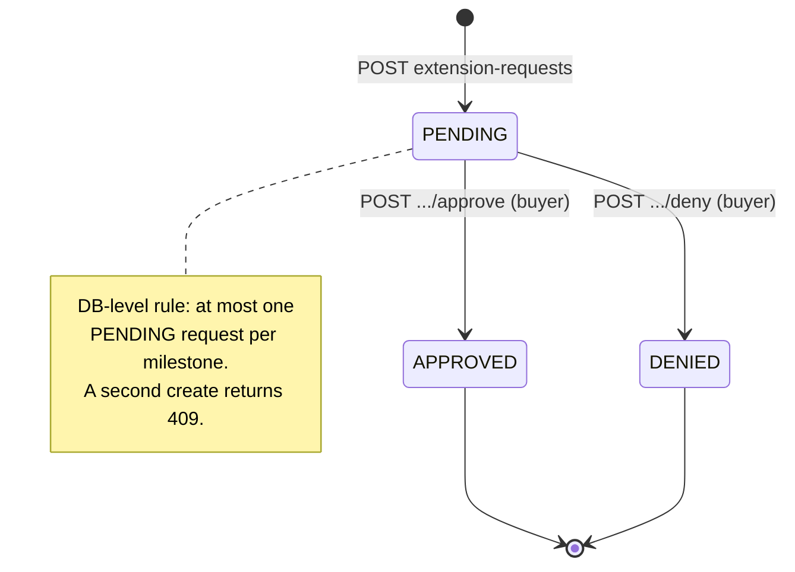

# Milestone Extensions and Checklists

This guide describes two milestone features that change how milestones behave:

- **Deadline extension requests** — a formal way for the party responsible for a milestone to ask the buyer for more time.
- **Milestone checklists** — a lightweight task list attached to a milestone that helps track readiness before proof is submitted.

Both features are scoped to a single milestone within a shipment. All endpoints below are relative to the API base URL and require authentication. For notification delivery and channel preferences, see [notifications.md](./notifications.md).

---

## 1. Deadline Extension Requests

A deadline extension request lets the responsible party propose a new `dueAt` for a milestone. The buyer reviews the proposal and either approves or denies it. At most one request may be pending per milestone at any time.

### 1.1 State Diagram



A request is created in `PENDING`. The buyer transitions it to `APPROVED` or `DENIED`. Terminal states (`APPROVED`, `DENIED`) cannot be changed. Once a request reaches a terminal state, a new request may be created for the same milestone (subject to the validation rules below).

### 1.2 Actors and Permissions

| Action | Endpoint | Allowed actors |
| --- | --- | --- |
| Create request | `POST /shipments/:shipmentId/milestones/:index/extension-requests` | Supplier, Logistics |
| Approve request | `POST /shipments/:shipmentId/milestones/:index/extension-requests/:requestId/approve` | Buyer |
| Deny request | `POST /shipments/:shipmentId/milestones/:index/extension-requests/:requestId/deny` | Buyer |
| View history | `GET /shipments/:shipmentId/milestones/:index/extension-requests` | All participants |

"All participants" means the buyer, supplier, and logistics parties on the shipment. Any other authenticated user receives `403`.

### 1.3 Validation Rules

When creating a request, the API enforces:

- `proposedDueAt` must be a valid timestamp **in the future**.
- `proposedDueAt` must be **later than the milestone's current `dueAt`**. Proposing an earlier or equal deadline is rejected.
- The milestone must **not** be in a terminal state (`CONFIRMED` or `RESOLVED`). Extensions on completed milestones are rejected.
- There must be **no existing `PENDING` request** for the milestone. A duplicate create returns `409 Conflict`.

When approving or denying, the request must still be `PENDING`. Acting on an already-decided request returns `409 Conflict`.

### 1.4 Side Effects of Approval

Approving a request applies the proposed deadline to the milestone:

- The milestone's `dueAt` is updated to the request's `proposedDueAt`.
- `overdueNotifiedAt` is reset to `null`.
- `overdueReminder3dAt` is reset to `null`.

Resetting the overdue markers ensures the overdue notification and the 3-day reminder can fire again against the new deadline. Denying a request has no effect on the milestone.

### 1.5 Example Requests

**Create an extension request (supplier/logistics):**

```http
POST /shipments/shp_123/milestones/2/extension-requests
Content-Type: application/json

{
  "proposedDueAt": "2025-07-15T17:00:00.000Z",
  "reason": "Customs clearance delayed at port of entry."
}
```

```http
HTTP/1.1 201 Created
Content-Type: application/json

{
  "id": "ext_456",
  "shipmentId": "shp_123",
  "milestoneIndex": 2,
  "status": "PENDING",
  "proposedDueAt": "2025-07-15T17:00:00.000Z",
  "reason": "Customs clearance delayed at port of entry.",
  "requestedBy": "usr_supplier_1",
  "decidedBy": null,
  "decidedAt": null,
  "decisionNote": null,
  "createdAt": "2025-07-10T09:12:00.000Z"
}
```

**Approve the request (buyer):**

```http
POST /shipments/shp_123/milestones/2/extension-requests/ext_456/approve
Content-Type: application/json

{
  "note": "Approved given the customs delay."
}
```

```http
HTTP/1.1 200 OK
Content-Type: application/json

{
  "id": "ext_456",
  "shipmentId": "shp_123",
  "milestoneIndex": 2,
  "status": "APPROVED",
  "proposedDueAt": "2025-07-15T17:00:00.000Z",
  "reason": "Customs clearance delayed at port of entry.",
  "requestedBy": "usr_supplier_1",
  "decidedBy": "usr_buyer_1",
  "decidedAt": "2025-07-10T14:30:00.000Z",
  "decisionNote": "Approved given the customs delay.",
  "createdAt": "2025-07-10T09:12:00.000Z"
}
```

**Deny the request (buyer):**

```http
POST /shipments/shp_123/milestones/2/extension-requests/ext_456/deny
Content-Type: application/json

{
  "note": "Deadline is contractual; please expedite."
}
```

The response has the same shape as the approve response, with `status: "DENIED"` and the `decisionNote` set.

---

## 2. Milestone Checklists

A checklist is a set of items attached to a milestone. Items help the responsible party track readiness. Each item has a `label`, a `required` flag, and a `completed` flag.

### 2.1 Endpoint Reference

All endpoints are scoped to a milestone:

| Method | Endpoint | Purpose |
| --- | --- | --- |
| `GET` | `/shipments/:shipmentId/milestones/:index/checklist` | List items and progress summary |
| `POST` | `/shipments/:shipmentId/milestones/:index/checklist` | Create an item |
| `PATCH` | `/shipments/:shipmentId/milestones/:index/checklist/:itemId` | Update an item (label, required, completed) |
| `DELETE` | `/shipments/:shipmentId/milestones/:index/checklist/:itemId` | Remove an item |

### 2.2 Permissions

| Action | Allowed actors | Conditions |
| --- | --- | --- |
| Read items | All participants | — |
| Create item | Buyer | Milestone must be `PENDING` |
| Remove item | Buyer | Milestone must be `PENDING` |
| Mark complete / reopen | Supplier, Logistics | — |
| Edit `label` / `required` | Buyer | Milestone must be `PENDING` |

The buyer owns the structure of the checklist (which items exist and whether they are required). The supplier and logistics parties own the execution (marking items complete or reopening them). Any participant may read the checklist at any time.

### 2.3 Progress Summary

`GET` returns the items plus a `progress` object:

```json
{
  "items": [
    { "id": "chk_1", "label": "Packing list uploaded", "required": true, "completed": true },
    { "id": "chk_2", "label": "Photos of pallet labels", "required": true, "completed": false },
    { "id": "chk_3", "label": "Optional insurance certificate", "required": false, "completed": false }
  ],
  "progress": {
    "total": 3,
    "completed": 1,
    "requiredTotal": 2,
    "requiredCompleted": 1
  }
}
```

| Field | Meaning |
| --- | --- |
| `total` | Number of items on the checklist |
| `completed` | Number of items with `completed: true` |
| `requiredTotal` | Number of items with `required: true` |
| `requiredCompleted` | Number of required items with `completed: true` |

### 2.4 Relationship to Proof Submission

Checklist completion does **not** block proof submission. When proof is submitted for a milestone, the API computes `incompleteRequired` — the list of `label` values for required items that are not yet complete. This list is returned with the proof submission response so the client can warn the user.

```json
{
  "incompleteRequired": ["Photos of pallet labels"]
}
```

The client should surface this as a warning (for example, a confirmation prompt), not as a hard error. Proof submission proceeds regardless. This keeps the checklist advisory while still encouraging completeness.

### 2.5 Example Requests

**Create a checklist item (buyer):**

```http
POST /shipments/shp_123/milestones/2/checklist
Content-Type: application/json

{
  "label": "Photos of pallet labels",
  "required": true
}
```

```http
HTTP/1.1 201 Created
Content-Type: application/json

{
  "id": "chk_2",
  "shipmentId": "shp_123",
  "milestoneIndex": 2,
  "label": "Photos of pallet labels",
  "required": true,
  "completed": false,
  "createdAt": "2025-07-10T09:20:00.000Z"
}
```

**Mark an item complete (supplier/logistics):**

```http
PATCH /shipments/shp_123/milestones/2/checklist/chk_2
Content-Type: application/json

{
  "completed": true
}
```

```http
HTTP/1.1 200 OK
Content-Type: application/json

{
  "id": "chk_2",
  "shipmentId": "shp_123",
  "milestoneIndex": 2,
  "label": "Photos of pallet labels",
  "required": true,
  "completed": true,
  "createdAt": "2025-07-10T09:20:00.000Z"
}
```

To reopen an item, send the same `PATCH` with `"completed": false`.

---

## 3. Notifications

Each step in the extension workflow emits a notification. Delivery channels and per-user preferences are described in [notifications.md](./notifications.md).

| Step | Notification type | Recipient |
| --- | --- | --- |
| Extension request created | `DEADLINE_EXTENSION_REQUESTED` | Buyer |
| Extension request approved | `DEADLINE_EXTENSION_DECIDED` | Requester |
| Extension request denied | `DEADLINE_EXTENSION_DECIDED` | Requester |

`DEADLINE_EXTENSION_DECIDED` is sent to the user who created the request (`requestedBy`) and includes the decision outcome. Checklist changes do not emit notifications; clients should poll or refresh the checklist as needed.

---

## See Also

- [shipment-lifecycle.md](./shipment-lifecycle.md) — milestone states, proof submission, and overdue handling
- [notifications.md](./notifications.md) — notification types and channel preferences