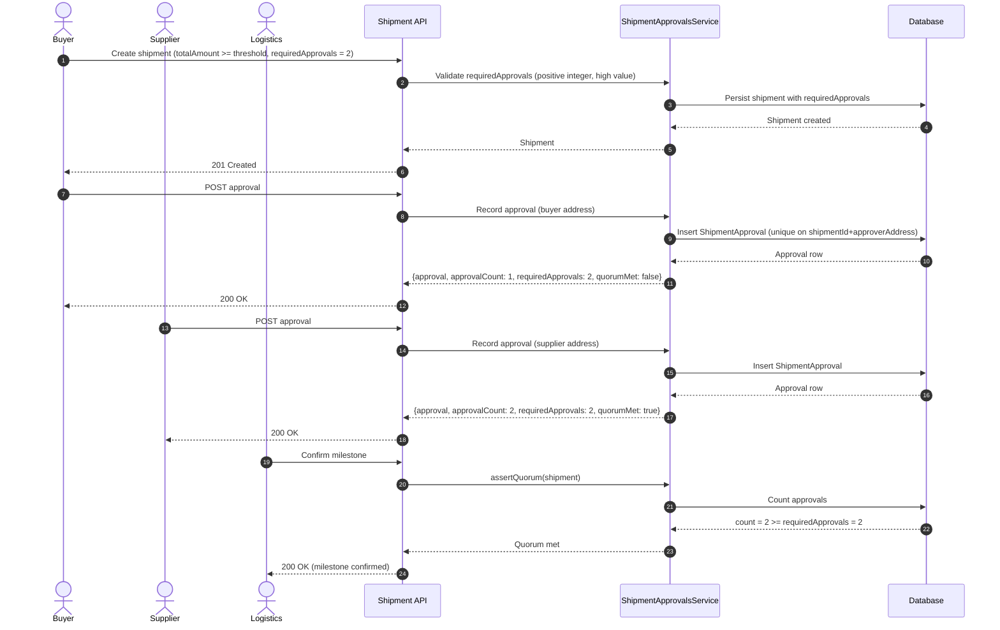

# Multi-Signature Approvals

High-value shipments require multiple participants to approve before milestones can be confirmed. This document explains how the value threshold is configured, how approvals are collected, and how quorum gates the shipment lifecycle.

## Overview

When a shipment's total value meets or exceeds a configured threshold, the shipment may require more than one approval before milestone confirmation is allowed. Approvals are recorded per Stellar address and counted against a per-shipment `requiredApprovals` value. Until the approval count reaches the required quorum, milestone confirmation is blocked.

For the broader shipment state machine, see [docs/shipment-lifecycle.md](./shipment-lifecycle.md). For notification behaviour around approvals, see [docs/notifications.md](./notifications.md).

## Configuration

### Environment variables

| Variable | Type | Default | Description |
| --- | --- | --- | --- |
| `MULTISIG_VALUE_THRESHOLD_STROOPS` | string (stroops) | `'1000000000000'` | Value threshold, expressed as a string of stroops. The default equals 100,000 USDC at 7 decimals. Compared against a shipment's `totalAmount` as a `bigint`. |

The threshold is compared against the shipment `totalAmount` using `bigint` arithmetic to avoid precision loss. A shipment whose `totalAmount` is greater than or equal to the threshold is considered "high value" and may opt into multi-signature approval.

### Per-shipment field

| Field | Type | Nullable | Description |
| --- | --- | --- | --- |
| `requiredApprovals` | integer | yes | Number of approvals required before milestone confirmation. `null` means the default single-approver flow. |

Rules for `requiredApprovals`:

- Must be a **positive integer** when provided.
- Is **rejected with HTTP 400** for shipments whose `totalAmount` is below `MULTISIG_VALUE_THRESHOLD_STROOPS`. In other words, only high-value shipments may request multi-signature approval.
- When `null`, the shipment uses the standard single-approver flow and quorum is treated as already met (see below).

## Token handling

Approvals are keyed by Stellar address:

- There is **one approval row per `(shipmentId, approverAddress)`**, enforced by a unique index. A given address can approve a given shipment at most once.
- Only **shipment participants** may approve: the buyer, supplier, logistics provider, or arbiter. Addresses outside the participant set are rejected.
- A **repeat approval** from an address that has already approved returns **HTTP 409 (Conflict)**.

## Approval lifecycle and blocking behaviour

### Recording an approval

`POST` an approval to the shipment approvals endpoint. On success the service records a `ShipmentApproval` and returns:

```json
{
  "approval": { "...": "..." },
  "approvalCount": 2,
  "requiredApprovals": 3,
  "quorumMet": false
}
```

- `approval` — the newly created approval record.
- `approvalCount` — total approvals recorded for the shipment.
- `requiredApprovals` — the shipment's configured requirement (`null` for the default flow).
- `quorumMet` — whether `approvalCount >= requiredApprovals`.

### Blocking milestone confirmation

Milestone confirmation is gated by `assertQuorum`. Until `approvalCount >= requiredApprovals`, confirmation is blocked with **HTTP 403 (Forbidden)**. Once quorum is met, confirmation proceeds normally.

### Checking approval status

`getApprovalStatus` returns the current state:

```json
{
  "required": 3,
  "count": 2,
  "quorumMet": false,
  "approvals": [ "...", "..." ]
}
```

- `required` — the shipment's `requiredApprovals` (`null` for the default flow).
- `count` — number of approvals recorded.
- `quorumMet` — whether quorum is satisfied. When `required` is `null`, `quorumMet` is reported as `true`.
- `approvals` — the list of recorded approvals.

## Admin overrides

There is currently **no admin override path** in `ShipmentApprovalsService`. Quorum is enforced strictly: no administrative action can bypass `assertQuorum` or force milestone confirmation while approvals are outstanding.

**Operational implication:** if a shipment becomes stuck because quorum cannot be reached (for example, a participant is unavailable), operators cannot resolve it through an override. Recovery must happen through normal participant action — the outstanding participant(s) must approve. Plan participant availability and `requiredApprovals` values accordingly before creating high-value shipments.

## Sequence diagram



If quorum is not met at the confirmation step, `assertQuorum` rejects the request with **403 Forbidden** and the milestone remains unconfirmed.

## Edge cases

### An approver leaves

If an approver leaves the organisation or becomes unavailable, **their existing approval row remains and still counts** toward quorum. There is **no removal endpoint** for approvals. Because approvals are additive only, plan `requiredApprovals` and participant availability up front so that quorum remains reachable if a participant departs.

### Rejection

There is **no reject endpoint**. Approvals are additive only. A participant who disagrees with a shipment simply **withholds approval**, which blocks milestone confirmation until quorum is otherwise satisfied. There is no explicit "rejected" state to record.

### Duplicate approvals

A repeat approval from the same address for the same shipment returns **409 Conflict** (enforced by the unique index on `(shipmentId, approverAddress)`). Duplicate attempts do not increment `approvalCount`.

## Related documentation

- [docs/shipment-lifecycle.md](./shipment-lifecycle.md) — shipment states and milestone confirmation.
- [docs/notifications.md](./notifications.md) — notifications emitted around approvals and confirmations.